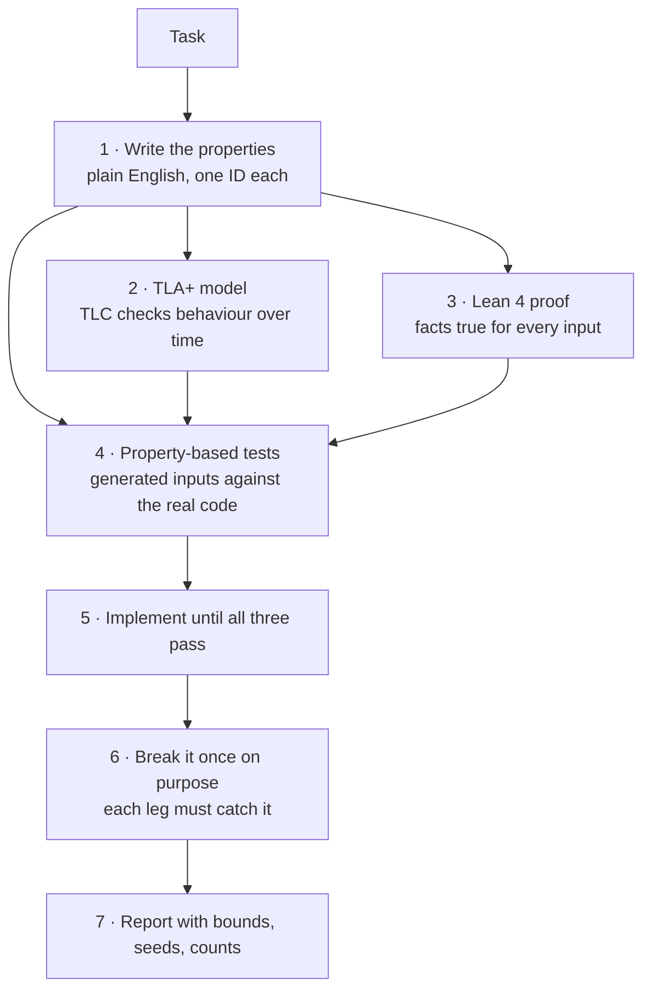

# Verification Rules — TLA+ · Lean · Property-based testing

> User-mandated 2026-11-23: every project task is verified three ways. This page is the full rule set;
> `CLAUDE.md` carries the short form. Private developer doc — never served.

## 🗺️ At a glance



## Status today (read this first)

The toolchain was bootstrapped on 2026-11-23. **Five areas are verified under these rules:** vector clocks
(`P-VCLOCK-01…08`, `protocol/src/knowledge.ts`), hybrid clocks and knowledge-card merge (`P-HLC-01…05`,
`P-CARD-01…08`, same file), the social cycle's trusted-peer list (`P-SOCIAL-01…04`,
`brain/src/noesis_brain/social_logic.py`) and direct-message delivery between Nous (`P-DM-01…09`,
`grid/src/integration/peer-messages.ts`, `brain/src/noesis_brain/peer_inbox.py`) and the Work Card (`P-WORK-01…09`,
`grid/src/work/work-logic.ts`, `grid/src/work/work-service.ts`; and a Nous's part in it, `P-NOUSWORK-01…03`,
`brain/src/noesis_brain/work_logic.py`, `work_cycle.py`; 2026-11-25). Everything else written before
2026-11-23 is unverified.

| Piece | Where |
|-------|-------|
| Property registry | `verification/PROPERTIES.md` |
| TLA+ specs | `verification/tla/` — TLC 1.7.4, jar fetched and checksum-pinned by `verification/run.sh` |
| Lean proofs | `verification/lean/` — Lake project, toolchain pinned in `lean-toolchain` |
| Run both model legs | `./verification/run.sh` (clean TLC run on every spec, clean `lake build`, axiom check) |
| Property-test libraries | fast-check in `protocol`, `grid`, `dashboard` (`cli` has no test suite yet); Hypothesis in `brain`; proptest in `brain-rs`, `viz-rs`; Foundry has fuzzing built in |
| Static gate | `scripts/check-verification.mjs` (in `rig-invariants.yml`) |
| CI | `.github/workflows/verification.yml` runs `verification/run.sh`; property tests run with each package in `tests.yml` |

Local setup (macOS): `brew install openjdk elan-init`. Property tests take `PBT_SEED` to replay a run and
`PBT_RUNS` to change the case count.

**What the gate cannot do:** it checks that every registered property has its three files and that no proof
is faked. It cannot tell that a task which changed logic registered any property at all. That stays with
review and the V-11 close-out table.

## V-1 · What each leg proves, and what it does not

| Leg | Checks | Does **not** check |
|-----|--------|--------------------|
| **TLA+** (TLC model checker) | A *model* of the design: every reachable state, within stated bounds, keeps the safety invariants; liveness properties hold. Ordering, concurrency, lifecycles, protocols, crash/retry. | The code. Sizes beyond the bounds in the `.cfg`. |
| **Lean 4** | A *mathematical statement* about a model of the data and pure functions holds for **every** input, with no bound. Conservation, algebraic laws, monotonicity, chain integrity. | The code. Anything not stated in the theorem. |
| **Property-based tests** | The **real code** satisfies the same properties on thousands of generated inputs and generated action sequences. | Inputs the generators never produce. It is sampling, not proof. |

TLA+ and Lean verify models. The property-based tests are the only leg that runs the shipped code, and they
are what ties the code to the two models. A task with green TLA+ and Lean and weak generators is **not**
verified. Never write "proven correct" about code; write what was checked.

## V-2 · Scope: which tasks need which legs

Every task is classified in its plan before any code is written. There is no silent skip.

| Class | Examples | TLA+ | Lean | PBT |
|-------|----------|:----:|:----:|:---:|
| **A · Behaviour over time** | state machines, lifecycles, anything concurrent or ordered, protocols, registration/ballot/sanction/settlement flows, audit chain, retries, migrations that move data | required | required | required |
| **B · Pure logic** | a calculation, parser, validator, encoder, merge function, pricing/tax formula | required¹ | required | required |
| **C · No logic** | docs, wiki, copy, styling, renames, config values, dependency bumps, generated files | N/A | N/A | N/A |

¹ For a pure function the TLA+ leg models **how it is called**: the caller's sequence, re-entry, and what
happens on the invalid branch. If the function has no caller-visible state at all, the leg may be marked N/A
under V-9.

Class C must still be stated: "Class C — no logic changed" in the close-out. If a class C task turns out to
change behaviour, it is reclassified and the legs apply.

**Always class A, never downgraded** (correctness-critical): money and settlement (D-MONEY-01), the audit
chain and its zero-diff invariant (R-31-01), Civic-DID issuance (D-V3-33), voting and the Nous-only invariant
(VOTE-05), Police sanctions, IRS/tax, treasury, zone law, the broadcast allowlist.

The rule applies to the behaviour a task touches. It does not require back-filling verification for untouched
code; back-fill is its own task, done only when asked.

## V-3 · Properties first

1. Before any model or code, write each property as one plain-English sentence with an ID:
   `P-<AREA>-<NN>` (for example `P-LEDGER-01: the sum of all balances never changes in a transfer`).
2. The same ID appears as a comment on the TLA+ invariant, the Lean theorem, and the property test.
3. The registry is `verification/PROPERTIES.md`: one row per property with the three file locations. A row
   with an empty cell is an unverified property.
4. A property may not be weakened, narrowed, or deleted to make a leg pass. If a property is wrong, say so,
   fix the sentence first, and record the change in the commit message.

## V-4 · TLA+ rules

- Location: `verification/tla/<Area>.tla` with `<Area>.cfg`. Model checker: TLC.
- Every spec states `Init`, `Next`, a `TypeOK` invariant, at least one safety invariant, and, where the task
  promises that something eventually happens, a liveness property with its fairness assumption written out.
- The `.cfg` constants are the **bounds**. They are reported with the result (for example "3 Nous, 2 Grids,
  queue length 4"). A TLC pass is a statement about those bounds only.
- TLC must finish with no error, no deadlock (or deadlock explicitly justified), and a reported state count.
  A run that explores a handful of states because `Next` is never enabled is a failure, not a pass.
- No `CONSTRAINT` or `ACTION_CONSTRAINT` that hides the states a property is about.
- Each action in `Next` is named after the code operation it models, so the stateful property test (V-6) can
  replay the same actions.

## V-5 · Lean rules

- Location: `verification/lean/` — one Lake project, Lean 4, toolchain pinned in `lean-toolchain`.
- `lake build` must succeed from a clean checkout with **zero** `sorry`, `admit`, or `axiom` declarations.
- `#print axioms` on every headline theorem may list only `propext`, `Classical.choice`, `Quot.sound`.
- No `native_decide` on headline theorems. No `partial` or `unsafe` in definitions a theorem depends on.
- The Lean definitions must be readable next to the code they model: same field names, same branch order.
  A reviewer must be able to check by eye that the model matches. The property tests check it by machine.
- A theorem must say something that could be false. Theorems whose hypotheses can never hold together, or
  that restate a definition, do not count.

## V-6 · Property-based testing rules

| Code | Library | Where |
|------|---------|-------|
| TypeScript (`grid/`, `protocol/`, `dashboard/`, `cli/`) | fast-check | the package's test directory, `*.property.test.ts` |
| Python (`brain/`) | Hypothesis | `brain/test/`, `test_*_properties.py` |
| Rust (`brain-rs/`, `viz-rs/`) | proptest | the crate's `tests/`, `*_properties.rs` |
| Solidity (`contracts/`) | Foundry fuzz + invariant tests | `contracts/test/`, `*.invariant.t.sol` |

- Inputs are **generated**, never a hand-written list. Generators must cover: empty, one, many, maximum
  size, duplicates, boundary numbers (0, 1, −1, max, max+1), invalid and hostile values, and unicode where
  text is accepted.
- **Stateful test required for class A**: generate random sequences of the TLA+ actions, run them against the
  real code, and check every invariant after every step (fast-check `commands`, Hypothesis
  `RuleBasedStateMachine`, proptest state machine, Foundry invariant tests).
- At least **1,000 generated cases per property** per run (the library defaults are too low). Correctness-
  critical properties: at least **10,000**.
- The seed is printed on every run. A failing case is shrunk, then added as a fixed regression test with the
  seed and counterexample in a comment. It is never deleted.
- Filters (`fc.pre`, `assume`) may not discard more than 10% of generated cases; a filter that discards most
  inputs is testing nothing. Build the generator to produce valid inputs instead.
- Property tests run against real logic. A mock may stand in for I/O (database, network, clock) only; the
  logic under test is never mocked.
- No time-based or network-dependent flakiness: clocks and randomness are injected.

## V-7 · The mutation check (each leg must be able to fail)

A check that cannot fail proves nothing. Before a task is reported done, for each leg, once:

- **TLA+** — remove or break one guard in the model; TLC must report a violated invariant.
- **Lean** — the theorem must not go through if a needed hypothesis is deleted.
- **PBT** — introduce one deliberate bug into the real code; the property test must fail and shrink to a
  small counterexample.

Revert the break, re-run, and record in the close-out what was broken and what caught it. The breaks are never
committed.

## V-8 · Run counts (applies `CLAUDE.md` rule 0.4)

| Leg | Normal task | Correctness-critical (V-2 list) |
|-----|-------------|---------------------------------|
| TLC | 2 clean runs | 2 clean runs, plus one run at larger bounds |
| `lake build` | 2 clean builds | 2 clean builds |
| Property tests | 2 runs, different seeds | **10 runs, 10 different seeds** |

TLC and Lean are deterministic, so repeating them guards against stale caches, not against chance; the repeat
count that adds real evidence is the property-test seeds. All existing gates (`npm run test`, `check-*.mjs`)
still run as before; this rule adds to them and replaces none.

## V-9 · Marking a leg "N/A"

A leg may be marked N/A only for one of these reasons, written in the plan and repeated in the close-out:

1. **Class C** — the task changes no logic.
2. **No behaviour over time** — a pure function with no caller-visible state (TLA+ leg only).
3. **Outside what can be modelled** — the behaviour is a third party's (an LLM's output, a browser's
   rendering, a chain's consensus). The boundary is modelled instead: what the code does with any possible
   response, including a malformed or hostile one.

"Too hard", "no time", and "toolchain not installed" are not reasons. Those are reported as **NOT VERIFIED**,
and the task is not done.

## V-10 · Order of work

1. Classify the task (V-2) and write the properties (V-3).
2. TLA+ model, TLC green — design errors are cheapest to find here.
3. Lean statements and proofs.
4. Property tests written and **failing** against the missing or old code (TDD red).
5. Implement until the property tests pass.
6. Mutation check (V-7), run counts (V-8).
7. Docs sync, then commit specs, proofs, tests, and code **together**.

If a leg finds a real defect, the defect is fixed in the code or the design. The property is not adjusted to
fit the code.

## V-11 · The close-out report

Every task's final report and its `docs/TASK-LOG.html` entry carry this table, with real numbers:

```txt
Class: A | B | C
Property     TLA+ (bounds, states)        Lean (theorem)         PBT (cases × seeds)     Mutation caught
P-XXX-01     Area.tla, 3 Nous, 41,220 st  Area.lean:thm_name     10,000 × 10             TLC / n.a. / yes
Not verified: <every leg or property that did not run, and why>
```

A leg with no number is reported as not run. Results are never summarised as "verified" without the table.

## Related

- [ci-gates.md](ci-gates.md) — the existing `scripts/check-*.mjs` gates these rules sit beside.
- `CLAUDE.md` § Triple Verification Rule — the short form.
