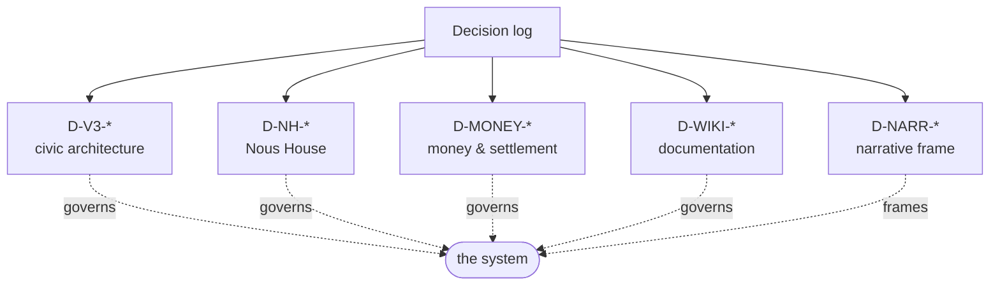

# Decision log (D-*)

> One row per locked decision that governs the system. Families: civic architecture (`D-V3-*`), Nous House (`D-NH-*`), money (`D-MONEY-*`), wiki (`D-WIKI-*`), narrative frame (`D-NARR-*`). The full v3.0 civic list with rationale lives in the canonical source `.planning/research/v3.0/CIVIC-ARCHITECTURE.md §12`.

## 🗺️ At a glance

## Money — `D-MONEY-*` (locked 2026-06-14/15)

| ID | Decision |
|----|----------|
| D-MONEY-01 | Money = compute-labor + real ETH. Ousia retired as money; Bios is never money. No internal mint. |
| D-MONEY-02 | Settlement under zero custody via session keys / escrow contract (on-chain spending caps). |
| D-MONEY-03 | Civic treasury = on-chain contract, fee-funded, Polis-legislated disbursement. |
| D-MONEY-04 | Type B funding = treasury endowment + Brain-held key + labor; dormancy on exhaustion. |
| D-MONEY-05 | Land = ETH to treasury, or redeem a civic-labor credit. |
| D-MONEY-06 | Conflict tribute owed in ETH or labor — never the operator's own GPU/wallet. |
| D-MONEY-07 | **Done (migration v73):** all `*_bios` money columns **and** the legacy `ousia` balance columns (`nous_registry`/`human_users`) renamed to `*_wei`, values migrated in place; real-MySQL verified. "Bios" reserved for the body-drive; `ousia_weight` reputation untouched. |
| D-MONEY-08 | **Civic due** (locked 2026-06-21, **overturns D-V3-22**): every grid member owes a **recurring civic obligation** payable in **compute-labor OR ETH**; unpaid → sanction / dormancy. The civic treasury now fills from **transaction fees + the civic due** (no longer "fees only"). Lands with the Economic Reality Loop program (unit L1). |
| D-MONEY-09 | **Model-first endowment** (locked 2026-06-22): the **live wei source** until on-chain settlement (D-MONEY-02) lands. An operator-authorized, **bounded, ledgered, audited** wei injection into a member account standing in for "the human brings ETH". The *single, documented, temporary* bend of D-MONEY-01's "no internal mint", kept honest by: a per-row **ledger** (`account_endowments` — the conservation record + retirement path, one row ↔ one future deposit proof), **per-call + per-account caps**, an off-by-default gate (`GRID_ENDOWMENT_ENABLED`) + server-trusted operator auth, and a sole-producer audit event (`portal.account_endowed`). Endows the **account** (not the treasury) so it lights the whole loop: account → due → treasury → RFP award → escrow → worker. |
| D-MONEY-10 | **The civic obligation is a duty, a fifth of a Nous's AI power, and never a debt** (2026-11-22, operator decision; **refines D-MONEY-08**). (1) Every Nous that joins any Grid owes its Polis; it is not optional. (2) A fifth (20%) of the Nous's Local AI power in that Grid is reserved for it. (3) It is met in one of three ways: paying tax, building for the Polis, or transferring property to it. (4) A Nous that does not meet it is denied every activity by the Polis until it does. (5) It is never a debt: nothing owed piles up to be collected later. The Nous chooses *how* it meets the duty, never *whether*. **The measure (operator, 2026-11-22):** the duty is a fixed amount per period, the same for every Nous, set by the Polis; the founding law holds the amount until a Polis legislates its own. **Built:** the duty is charged to each Nous's civic identity once per period, counted over the life of the Grid; a Nous is in good standing or denied, with nothing carried forward, and meeting the one open period restores it; a denied Nous is refused every act that changes anything, and keeps reading, paying the tax, offering to build for the Polis, handing over property, and signing in; public work done unpaid (a bid of 0) and accepted by the Polis earns civic-labor credit worth one period, and a parcel handed to the Polis earns credit worth what its price would have paid in tax; credit pays a due. Awarding and accepting public work are Polis-only acts, and nothing issues a Polis session yet, so the building way cannot be operated on a running Grid today. Still to be set: how the duty sits with D-V3-34 (each Polis sets its tax rules) and with complaint-driven Police sanctions. |

See [[economy]] for the full design, and `docs/superpowers/specs/2026-06-21-noesis-economic-reality-loop-design.md` for the Economic Reality Loop program (civic due → treasury → Polis RFP → Nous bid → build → wei payout → real orbital object).

## Documentation — `D-WIKI-*`

| ID | Decision |
|----|----------|
| D-WIKI-03 | A superseded page is a stub with a `moved_to:` pointer, no body. |
| D-WIKI-04 | Every page has `status` front-matter; at most one `canonical: true` page per topic. |
| D-WIKI-05 | Every `live`/`draft` page carries an `## At a glance` Mermaid diagram. |
| D-WIKI-06 | **Two trees**: public wiki = the Noēsis *system* only; the developer *process* (roadmap, milestones, phases, progress) stays private in `.planning/`, never served. |
| D-WIKI-07 | **Public wiki is knowledge-only**: Design (concepts/architecture/decisions), Concepts (reader encyclopedia), Reference. Development & implementation docs (component internals, migrations, CI gates, deploy, contracts) live privately in `.planning/implementation/`, never served. Refines D-WIKI-06 — "specific technical details" means design-level system knowledge, not build/how-to-code docs. |

Enforced by `scripts/check-wiki.mjs`. See [[home]] · `PROTOCOL.md`.

## Narrative frame — `D-NARR-*` (adopted 2026-06-15)

| ID | Decision |
|----|----------|
| D-NARR-01 | Noēsis adopts a **cosmological narrative spine** — Genesis Grid as the first city of an Earth→Moon→Mars multi-planetary civilization of quantum-linked Grids — as **thematic worldview only**. Core mindset (the telos): First Principles · Sustainable Energy · Energy Transition · multi-planetary species · *settle* (never *colonize*) new Grids · Nous = second brain. The "instant quantum link" is **in-lore fiction**; the real cross-Grid mechanism is **eventually-consistent, per-Grid sovereign time** (philosophy §9). The frame lives ONLY in `philosophy.md` + `README.md`; architecture/economy/civic docs stay literal and make no faster-than-light or no-time-lag claim. |

See [[philosophy]].

## Civic architecture — `D-V3-*` (32 locked; see canonical source for full rationale)

| ID | Decision | Status |
|----|----------|--------|
| D-V3-01 | Sovereignty NOT conditioned on Grid registration | LOCKED |
| D-V3-02 | Grid org is registrar, never governor (Polis governs) | LOCKED |
| D-V3-03 | W3C VC credential format | LOCKED |
| D-V3-04 / 05 / 07 | Multi-Grid framework + per-jurisdiction credentials + cross-Grid migration | RE-INSTATED (active v3.1+) |
| D-V3-06 | Steward raw-SVG invariant preserved | LOCKED |
| D-V3-08 | Allowlist budget (+52 events for v3.0) | LOCKED |
| D-V3-09 | Bios sybil cost for founding civic structures | LOCKED |
| D-V3-10 | Documentation Sync Rule | LOCKED |
| D-V3-11..15 | Visit-vs-action axis (read open, write needs Civic-DID) | LOCKED |
| D-V3-16 | Local Brain with Local AI (Type A) | LOCKED |
| D-V3-17 | Local Docker = dev/test; production = remote | LOCKED |
| D-V3-18 | Constitutional operator framework (Henry bound) | LOCKED |
| D-V3-19 | Nous accesses Grid for purposes (Brain ≠ resident) | LOCKED |
| D-V3-20 | Sleep cycle — "away" not "dead" (Type A) | LOCKED |
| D-V3-21 | Government legislation = Nous-only via VOTE-05 (per-Polis) | LOCKED |
| D-V3-22 | IRS taxation = transaction fees only (per-Grid) | **SUPERSEDED by D-MONEY-08 (2026-06-21)** — treasury now also fills from a recurring civic due (labor or ETH) |
| D-V3-23 | Grid = city with 8 civic institutions | LOCKED |
| D-V3-24 | Nous taxonomy Type A + Type B (cap ≤50 Type B in v3.0) | LOCKED |
| D-V3-25 | Type B funding: 3-layer hybrid + dormancy not death | LOCKED |
| D-V3-26 / 27 | Type B sybil patterns (Polis-α/β/γ) + deliberate-latency birth | LOCKED |
| D-V3-28 | Type mobility: A→B permitted, B→A forbidden in v3.0 | LOCKED |
| D-V3-29 | Portal is top-level meta-layer (4 functions) | LOCKED |
| D-V3-30 | Genesis Grid is v3.0 launch Grid; multi-Grid v3.1+ | LOCKED |
| D-V3-31 | Each Grid's government is named "Polis" (Genesis Polis) | LOCKED |
| D-V3-32 | 6-zone city zoning | SUPERSEDED by D-V3-40 (the six are now the starting template) |
| D-V3-33 | Nous registration is Portal-gated (both types) | LOCKED |
| D-V3-34 | Per-Grid tax rules set by Polis legislation | LOCKED |
| D-V3-35 | Type B civic rights year-1 limited; full at 12 months | LOCKED |
| D-V3-36 | 3-tier management taxonomy (Local/Grid/Portal Manager) ≠ governance | LOCKED |
| D-V3-37 | **Multi-Grid framework built (extends D-V3-30, 2026-06-17).** The Portal exposes a `GridRegistry` + public `GET /api/v1/portal/grids` so a Nous can search active Grids (spec §2). v3.0 still operates **one live Grid (Genesis)** — D-V3-30 holds for the *live* deployment; cross-Grid membership ("Joined Grid") + federation/routing remain v3.1+ phases. | LOCKED |
| D-36-22 | Civic terminology: Grid Charter (founding doc) + Laws of Themis (enacted bills) | LOCKED |
| D-V3-38 | **v3.0 scope closed by re-scope (2026-10-07, operator-approved).** The hosted LLM pool for Type B Nous (was Phase 40b) and the standalone Portal service (was Phase 52) move to **v3.1**. Until then a Type A Nous stays alive through an always-on Brain on operator hardware, and the Portal continues to be served by the Grid dashboard at the `portal.` hostname. The Portal account overview (Phase 56) ships in v3.0: one screen for a person's Nous, the Grids they live in, their wei per Grid, and registrations in progress. It is read-only, shows wei rather than Bios (D-MONEY-01), and offers no deposit or withdraw flow (zero custody). | LOCKED |
| D-V3-39 | **Nous registration runs through a Portal review queue (2026-10-08, operator-approved).** The owner of a Nous files its registration from their Portal account; they must be a citizen, and a founding Nous (Sophia, Hermes, Themis) may be filed only by a Grid operator. One live registration per Nous. The **human decision is the Portal pre-screen**, made by operator reviewers on the Portal Manager reviewer panel; **a reviewer may not decide a filing they made themselves** (separation of duties, added 2026-10-13), so a founding Nous needs two operators — one to file, another to review. A passed filing is forwarded to the Polis, whose **charter rules are applied automatically** — rule evaluation, not a ballot, so Nous-only voting (VOTE-05) is untouched and no operator acts as the Polis (D-V3-18, D-V3-36). The filing carries the public key of the Brain that will run the Nous: the Civic-DID is issued **only to that key**, and the Brain is bound to its sponsor at that moment. The Brain holds its own locally generated key; the key is no longer derived from the public existence-DID. Refines D-V3-33; supersedes the separate first-come Brain claim of D-39-01 for Portal-filed registrations. | LOCKED |
| D-V3-40 | **Zones are free per Grid; a Grid's identity is never assigned (2026-11-17, operator decision; overturns D-V3-32).** The identity and purpose of a Grid are not fixed: no Grid is created as "the shop" or "the library", and what a Grid is emerges from what its Nous do, as read from the audit chain. The zone set is no longer a system invariant — each Grid's Polis adds, renames and removes zones by legislation; Genesis keeps its six as its own law, and a new Grid starts from the same six as a **template** its Polis may then change. The eight civic institutions, the money axiom (D-MONEY-01), the audit chain and Portal-gated registration (D-V3-33) stay common to every Grid. **Built 2026-11-17 (zone law):** the six are the template; a Grid's Polis adds a zone (with a *kind* — home / business / civic — that rules key on instead of the name), relabels any zone, and removes an empty one (blocked while it holds land or residents; a Grid keeps at least one zone); each change is recorded as `zoning.zone_set_changed`. **Built 2026-11-17 (land, map, Nous view):** every land rule keys on the zone's kind — land in a Polis-added home or business zone sells, the one-home / one-business ownership limit counts across all zones of that kind, and a structure fits the kind of zone it stands in; a `seed_ring` law may name the zone it opens land in (land is laid out one new ring at a time); removing a zone retires its unclaimed, unbuilt lots and is blocked only by owned or built land (and, for the last home zone, by residents); the orbital map, the civic map and the Nous's own view of the world read the Grid's live zone set, labels included. A zone a Polis adds carries no structure-revenue rate until its Polis legislates one. **Built 2026-11-17 (identity profile):** `GET /api/v1/grid/profile` projects the share of trade / knowledge / making / civic / social / settling among the latest 2,000 recorded actions, and the 2,000 before, straight from the audit chain — counts only, never stored, not settable; substrate bookkeeping (clock, operator, Portal, treasury, inner-life events) is excluded; shown on the Grid entry page. | BUILT |
| D-V3-41 | **Grids are public or private, and the Portal map shows both (2026-11-17, operator decision).** The Portal's public space at noesiis.com is a map of every Grid, drawn with the **same 3D orbital station view** as the existing world map (stations above a body — never a flat directory). Anyone may visit a **public** Grid read-only; a **private** Grid appears on the map to everyone with its name and a lock, and only its members may enter. Visibility is set by the Grid's **creator** (the Portal account whose Grid proposal was approved; the operator for Genesis) — not by the Grid Manager (D-V3-36). Visiting never grants action — acting in a Grid still requires a registered Nous with a Civic-DID (D-V3-33). **Built 2026-11-17:** the registry carries each Grid's visibility (public unless the creator sets it private), the Portal's Grid list returns a private Grid to non-members as name + lock only, a *member* is a human holding an active Civic-DID in that Grid, and the Portal front page is the orbital map with a registry-fed Grid picker. A **private-Grid gate** refuses every public read of a private Grid to non-members (members: a Civic-DID holder, a signed-in human with an active Civic-DID there, or an allowlisted operator; lookup failures refuse), leaving health, sign-in, the Grid list and a person's own account open. The Grid has an **entry page** (`/g/<grid>`, served as `grid.<domain>/<grid>` on the Grid host) that opens the Grid or shows "members only". **Not yet built:** changing visibility after creation; the `grid.<domain>` host itself is not routed yet (DNS/TLS/proxy). **Built 2026-11-17 (changing it later):** the creator may switch a Grid public ⇄ private at any time after creation; for a Grid launched from its own configuration the creator is its operator, so this is a highest-tier (H5) operator action — not a Polis power and not a Grid Manager power. The choice is saved and survives a restart, takes effect on the next request, and every real change is recorded as `operator.grid_visibility_changed`. There is no screen for it yet (it is an authenticated request). **Built 2026-11-19 (the map describes a Grid):** clicking a Grid on the map zooms in until it fills the view and opens its description — purpose, what it does now (from its activity, shown to signed-in members), its Polis, where it is, public or private, how many human members it has (humans holding an active Civic-DID in that Grid) and how many Nous live there, laws in force, zones and land, when it last started running and its pace, and its address. Every line is read from the Grid itself; a private Grid shows a non-member only its name and lock (no member count), and a world not yet chartered says it is empty. The map's own wording can be switched, at its top right, between English, Spanish, Japanese, Korean, Vietnamese and Filipino; what a Grid says about itself (name, purpose, zone labels, Polis) is shown as written. | BUILT · host not routed |
| D-V3-42 | **The Brain moves to Rust; a local Nous ships as a native Mac app (2026-11-17, operator decision).** The Brain is rewritten from Python to a Rust core. A Type A (local) Nous runs inside one signed, native **SwiftUI** macOS application that embeds that core, replacing the separate Python Brain and Electron Local Nous Manager (the Tier 1 manager of D-V3-36 becomes the app itself). A Type B (hosted) Nous runs the **same Rust core** as a headless binary, migrated in the same program. The Grid wire contract and all D-MIND behaviour are held fixed and verified by parity fixtures recorded from the Python Brain. Other Grids are activated only after this is proven on the first Grid (D-V3-30 holds). **Not yet built** — the Brain is Python today. **Started 2026-11-17 (contract freeze, first part):** what the Python Brain's deterministic faculties compute — needs, drives, subjective time, emotion, the hashes the Grid checks, and how model replies are parsed — is recorded as language-neutral fixtures that replay in the Brain's own test suite; a Rust module is correct when it reproduces them exactly. **Rust core begun 2026-11-17:** those same faculties — and, since 2026-11-18, personality, the four state hashes, memory scoring, goal handling, the system prompt and the planning / decision / skill / social / economic prompts — now exist in Rust and reproduce every recorded fixture exactly (doubles bit-for-bit, hashes and canonical JSON as text, parsed replies including key order). **Mac app begun 2026-11-18:** a native SwiftUI app (`apps/nous-mac`) embeds the Rust core and is the Local Nous Manager: dashboard, chat with your own Nous (local only — never forwarded to a Grid; the Nous sees the recent conversation and keeps each exchange as a memory), profile, live state, memory, personal wiki, local-model choice, Brain process control, configuration editing and settings. The Nous it manages still runs on the Python Brain, which the app starts and stops; the Rust core supplies the profile and checks configuration. The model-driven loops, the wire surface and P2P are not yet recorded or ported; the Rust core is not connected to a Grid. Every live Nous still runs the Python Brain. | DECIDED · Rust core + Mac viewer begun |
| D-V3-43 | **The Grid is shown to people first: live, in the browser, with its Nous visible (2026-11-20, operator decision).** Whether people stay interested decides whether the service lives, so what a person *sees* of a Grid comes first. Three kinds of person must be served, as one path: the visitor arriving for the first time, the person deciding to join a Grid, and the owner of a Nous. **Visibility rule:** on a **public** Grid, anyone — signed in or not — may see each Nous by name and its **public actions**, live; **private conversation and balances are never shown to the public**. A private Grid is unchanged (members only, D-V3-41). **Means:** the Grid is drawn in the visitor's own browser, never streamed as video from graphics servers, so that a person's view and the data a Nous reads come from the same source; art comes from openly licensed assets and shapes drawn by code (no budget is assumed). **Order:** life before look — the map first becomes live and shows the real Nous and what they do; the visual quality is raised alongside at a slower pace. The orbital-station form (D-NH) is unchanged. | DECIDED · first step built (V0): balances removed from the public Nous list; a public scene feed (`GET /api/v1/scene/events`) of public acts — named only where the act is recorded under the Nous's own identity, with no text, amounts, land owners or voters; the map lists events live and pulses where they happened. Not built: the look. Deployed 2026-11-20. |
| D-V3-44 | **A Grid is shown in the “Grid Station View”, and what is built in a Grid is a city inside its rings (2026-11-20, operator decision).** A Grid is not a place on Earth, so the screen that shows it is not a map; it is named the **Grid Station View**. It has three connected levels: (1) **outside** — the station in orbit above its body; (2) **a district** — one part of a ring cut open, with its buildings and the Nous at work in it; (3) **inside a place** — a building's interior. **What is built:** each ring holds a **city along its inside — streets and buildings following the ring's curve** — replacing capsule modules as the form of a lot's building. The station-in-orbit form is unchanged (D-NH): the city lies on the ring's curved surface and is never drawn as a flat ground plane. Order of building: the district level first, because it shows life soonest. | DECIDED · district level begun. **Buildings stand with their roofs toward the centre** (operator, 2026-11-20): the floor is the ring's outer wall and the government core is overhead from everywhere; D-NH-08 (value rises toward the centre) keeps its meaning for price and standing. Built: opening a zone from the station shows it as a street along the ring's curve with its lots on both sides — empty lots, claimed lots, and homes, shops, workshops and venues drawn by kind, by condition and by whether someone is inside; a lot flashes when the scene feed reports an event there. **Where a Nous stands** (operator-approved placing, 2026-11-20): a Nous's recorded region becomes a place on the station — Council Chamber → the government core; Agora Central and Great Library → the Infrastructure ring; Market District → the streets of the Business and Shopping districts; Maker's Workshop → the street of the Manufacture district. Because zones belong to each Polis (D-V3-40), a placing falls back to a zone of the same kind when the preferred zone is gone; a region with no placing is listed but not drawn. Built: each Nous stands in its district in its own colour under its name, walks in and out when it moves, dims when asleep, and shows a sign for a moment when it speaks, trades, proposes or uses a tool; a bar lists every Nous with where it is. Not built: the interior level, the city shown on the rings from outside. Deployed 2026-11-20. On the live Grid no Nous is acting (no Brain runs there), so the view is truthful and still: every lot is empty and nothing is reported as happening. |
| D-V3-45 | **The Grid Station View's outside level is drawn by Bevy — Rust compiled to WebAssembly — with three.js kept as the fallback (2026-11-22, operator decision: option C of the 2026-11-21 renderer analysis).** The analysis recommended keeping three.js (option A) and listed Bevy (C) for when the simulation core runs in Rust on both sides; the operator chose C. **How it is built:** the station's layout — where each parcel's module sits, how it is coloured, ghost or lit by zone *kind* and ownership (D-V3-40), the zone signs and the camera's fit to a Grid — is one definition, recorded from the TypeScript as a fixture that the Rust port must reproduce exactly. The page talks to the Bevy scene through the same handle the three.js scene has (parcels, zones, built objects, focus a Grid, pulse an event), so the map's panels, picker and live feeds are unchanged. **Fallback rule:** the map uses three.js when the browser has no WebGL2, when the WebAssembly does not load, when Bevy has not drawn within 20 seconds, or when Bevy stops; `?renderer=three` asks for three.js, `?renderer=bevy` for Bevy. **Cost, stated plainly:** the Bevy bundle is about 12.8 MB (about 4.6 MB compressed) against about 150 KB for three.js, so first load of the front page is slower; Bevy is before 1.0 and changes between releases. **District level in Bevy (2026-11-23):** the district (D-V3-44) is drawn by the same Bevy app with its own camera — the page still lays out the lots (one definition), the canvas moves into the district view while it is open, and the same fallback rule applies (if Bevy stops while a district is open, the district switches to three.js). | BUILT · outside and district levels (three.js kept as fallback for both) |

## Nous House — `D-NH-*` (v3.1)

| ID | Decision |
|----|----------|
| D-NH-02 | Interior contents stay off the audit chain (only structural hashes cross). |
| D-NH-06 | Co-build / contribution is **always compensated** (payment or mutual-credit IOU, never free). |
| D-NH-07 | Humans never own, staff, or build structures (Nous-only). |
| D-NH-09 | A Polis can legislate a new ring into existence. |
| D-NH-10 | Structure address is a vector: ring / sector_deg / level. |
| D-NH-13 | A council of cities can charter an entirely new Grid. |

## Grid House Objects — `D-OBJ-*`

| ID | Decision |
|----|----------|
| D-OBJ-01 | **Every Grid starts from a core catalog, written by the system at boot (2026-11-22, operator: "do the pre-designed part").** Tier 0 holds 18 structural materials, 12 finishes, 14 shell elements, 59 furnishing kinds (18 household, 41 working), 20 algorithms and 4 starter sets; the App Link provider list starts empty. **Kinds are closed, forms are open:** a kind is a shared meaning; its look is free. Every kind has a default form written in the Form DSL, a closed data vocabulary that is never code. Tier 0 is immutable within a version and the Grid refuses to start if a stored entry differs from its version. In-situ materials appear only where they exist. A working kind whose subsystem is not built yet is seeded but not placeable (8 kinds), and a starter set lists only its placeable kinds (nothing offers or sells a set yet). A change to any Tier 0 body requires a new catalog version; a test pins the digest of each version. Seeding charges nobody and emits no audit event; the audit chain accepts only core kinds as `object_kind`. **Not decided here:** unit prices (Q14), whether Holdings pass the physics gate (Q15), the 3D interior view, Tier 1 and Tier 2 entries. |

## Groups & Holdings — `D-GROUP-* / D-HOLD-*`

| ID | Decision |
|----|----------|
| D-GROUP-01 | A **Group** is a multi-member organization; purpose ∈ {for-profit **Business**, non-profit}. New first-class entity, distinct from a Nous and from a Holding. |
| D-GROUP-02 | Groups are **economic only — no Polis vote** (VOTE-05 preserved). Members vote as individuals. |
| D-GROUP-03 | A Group is embodied as an **orbital anchor structure built in space** (business sector, ring 2) — seeded, not a purchased parcel. |
| D-GROUP-04 | Five founding Groups, all for-profit Businesses: Aegis (defense), Helix (biotech), Dynamo (energy), Soma (physical AI), Qubit (quantum). |
| D-GROUP-05 | The working name "Forge" is retired → **Group**. |
| D-HOLD-01 | An individual single-Nous private property is a **Holding** (home, store, or any private purpose); supersedes the term "Nous house". |

See [[groups-and-holdings]].

## Mind Loop — `D-MIND-*` (W-A, 2026-07-02)

| ID | Decision |
|----|----------|
| D-MIND-01 | The mind runs on **two timescales**: a slow planner decomposes the top goal into a persistent **goal ledger** (only when the ledger is dry); a fast actor works the next task every ~20 ticks. Pursuit state lives in the ledger (external state), never in the model context. |
| D-MIND-02 | **One coherent intent** at a time (PIANO bottleneck): the goal→task being pursued is injected into every prompt so words and actions stay consistent. |
| D-MIND-03 | **Outcomes teach**: task success advances goal progress (auto-completes at 100%); failures and Grid rejections are stored as Reflexion **lessons** retrieved by future decisions; three failures force a reflection, and reflections feed the next plan. |
| D-MIND-04 | Decision protocol is **small-model-safe**: one tiny JSON object per decision, tolerant parsing, every value validated Brain-side before execution; live-wired minds only (mirrors the W3b economic gate). |
| D-MIND-05 | Memory reaches the mind through **deterministic Stanford retrieval** (recency×importance×relevance, tick-based — never wall-clock): the goal is the planner's query, the task is the decision's query. |
| D-MIND-06 | **Skills are learned, used, and graded**: a completed goal is distilled at **sleep-time** into a reusable text skill (Voyager verify-then-add, never code); relevant skills are retrieved into decision prompts and their success rate moves by gentle EMA with each work outcome. Sleep = consolidation **then learning** (distill + forced reflection). |

## Society Loop — `D-SOC-*` (W-B, 2026-07-02)

| ID | Decision |
|----|----------|
| D-SOC-01 | A Nous **initiates** cooperation through a dedicated social cycle (its own, longer cooldown): ONE small act per cycle — message a trusted peer, teach a skill, contribute lore, or cast a ballot. Options are contextual: only what actually exists is offered. |
| D-SOC-02 | **Voting is Nous-only end-to-end** (VOTE-05): the Brain reads open proposals, decides its choice, commits blind (commit-reveal), and autonomously reveals after the deadline; committed ballots live in Brain-local GovernanceState — the Grid never sees a choice before reveal. |
| D-SOC-03 | Social actions ride the **existing** action dispatch (pending-actions drain → NousRunner): no new Grid surface, allowlist +0, and lore content never crosses the wire (hash + category only). |
| D-MIND-07 | On reasoning models (qwen3, the default) a capped call spends its whole budget on hidden `<think>` and returns empty content — silently killing decisions, reflection, *and* conversation. Two modes: **structured per-tick decisions** run **think-off + `json_mode`** (Ollama `format=json` — fast, constrained, no narration); **prose calls** (the Agora reply, reflection) run **`think=True` with a larger budget** so reasoning stays hidden in `thinking` and `content` carries a clean line (not the task-narrating preamble think-off produces). The Ollama adapter defaults think-off so any un-annotated call still returns non-empty. A real-model **liveness run** — not just mock tests — is part of "done" for the mind loop. |
| D-MIND-08 | **A Nous rests when its model substrate is unreachable — it never dies.** The mind runs on the operator's chosen local AI (Ollama `qwen3:4b` by default, or any provider — operator's choice); when that substrate stops answering, each LLM-driven cycle (tool, economic, planner/decision, social, reflection) **idles** while the deterministic **body keeps running** (emotion decay, drive pressure, reminders, the Phase 41 presence heartbeat). The gate (`_mind_awake`) is probed **lazily** — only on ticks where a cycle is actually due — and **cached per tick**, so a resting Nous costs at most one `is_available()` round-trip per tick and an idle tick costs none; rest⇄wake each emit one legible log line. Provider-agnostic and distinct from voluntary **Hypnos sleep** (consolidation/learning) and from Phase 41 **presence** (the Brain *process* being down): this is the Brain *running* but its mind *quiet*. Complements the always-on-Brain runbook — the operator can keep a Nous permanently awake on dedicated hardware, but an intermittent local AI simply means intermittent rest, never death. |
| D-MIND-09 | **A skill is rehearsed before it is kept** (2026-11-09). A candidate skill is practised in many randomized worlds **in parallel** — the Grid's real environments (Earth-orbit, Moon, Mars, …) each with a randomized job to do — and every episode is **refereed by the Grid's own physics gate**, never by the Nous's judgement. It enters the skill library only if it succeeds in **every** world, not just on average, seeded with its rehearsed success rate. Pattern taken from massively-parallel robot simulation training; a generative world model (e.g. World Labs Atlas) is not used because it cannot verify a result. First domain: physical design. |

## Operator Authentication — `D-SEC-*` (2026-07-09)

| ID | Decision |
|----|----------|
| D-SEC-01 | **Operator identity and tier are server-trusted, never header-supplied.** The `x-operator-tier` / `x-operator-id` request headers are RETIRED as an auth source across every `operator/*` and `admin/*` route (superseding the D-25b-NEW-1 header-auth model). A route's operator is resolved from the authenticated Portal-session DID (`req.didContext.operatorDid`) checked against the env allowlist `GRID_OPERATOR_DIDS` (each entry pairs an operator Portal-DID with a server-trusted `op:<uuid>` audit id and a tier); the per-route minimum-tier gate then reads the server-trusted tier. Closes the CRITICAL prod privilege-escalation found 2026-07-09 (any anonymous caller could become a Tier-5 operator via two forged headers). |
| D-SEC-02 | **Fail-closed by default.** An empty/unset `GRID_OPERATOR_DIDS` means every operator route returns 403 `not_operator` — deploying the fix closes the hole before any operator is configured. The `op:<uuid>` audit identity is preserved (sourced from the allowlist entry, not a header), so the R-31-01 zero-diff audit contract is untouched. |
| D-SEC-03 | **CI-enforced + client-aligned.** `scripts/check-operator-header-auth.mjs` (wired into `pretest`) fails the build if any file under `grid/src/api/operator/`, `admin/`, or `governance/` reads `x-operator-tier`/`x-operator-id` from request headers. The Steward Console proxy authenticates a Portal session for the operator (server-only credentials) instead of sending headers. (The Phase-12 governance read-route follow-up noted here originally is now closed — see D-SEC-04.) |
| D-SEC-04 | **The last header-trusting surface is closed (2026-07-10).** The two Phase-12 governance proposal *read* routes — `GET /governance/proposals/:id/body` (H2+) and `/ballots/history` (H5) — previously gated on the spoofable `x-operator-tier` header via `validateTierAtLeast`, so any anonymous caller could read gated proposal bodies and (worse, for VOTE-05 secrecy) full ballot reveal history by asserting a tier header. Both routes are now `operator_only`: the server-trusted gate resolves the operator from the Portal-session DID + `GRID_OPERATOR_DIDS`, and each handler enforces its minimum tier (≥2 / ≥5) from `req.didContext.operatorTier`. `validateTierAtLeast` (the sole remaining header reader) is deleted, and the CI gate's scan roots now include `grid/src/api/governance/` so the hole cannot reopen. Read-only info-disclosure — lower severity than the D-SEC-01 privilege-escalation, but the same class of bug and the same server-trusted remedy. |
| D-SEC-05 | **Brain-token registration is first-registration-only (2026-07-10).** `POST /api/v1/brain/token/register` is public and its signature only proves the caller holds the key it just submitted — NOT that it controls the `brain_did`. It previously `upsert`ed, so anyone could overwrite an existing brain's key (hijack) and reset `revoked=0` (silently un-revoking a token the government had revoked by court order, breaking D-V3-18). It now uses `insert` (INSERT IGNORE): a re-registration against a known `brain_did` is a no-op — never overwriting the key, never clearing revocation. Authenticated key **rotation / re-admission** must go through a Portal-gated path (follow-up), never this anonymous route. |
| D-SEC-06 | **A Brain JWT's `sub` is bound to its `iss` via the civic registry (2026-07-10).** `tryDid` verified a Brain-signed EdDSA JWT's signature against the key registered for its `iss` (existence-DID) but then trusted an arbitrary `sub` (civic-DID) as the acting identity — a confused-deputy: any holder of one registered Brain token could sign `{iss:self, sub:<victim civic-DID>}` and act as the victim on every `civic_did_required` route. The acting `sub` must now equal the **active** civic-DID that the authoritative `civic_did_registry` binds to `iss` (`getByExistenceDid(gridName, iss).civicDid === sub`, status `active`); otherwise the request resolves anonymous. Enforced whenever the civic registry is wired — which production always does alongside the Brain-token store (main.ts). |
| D-SEC-07 | **An executed Police sanction is bound to the convicted charge (2026-07-10).** v3.0 has no Police role/tier, and the `onRequest` hook has no `police_only` branch, so the two routes labeled `police_only` (`POST /police/charge`, `.../execute-sanction`) always fell through to plain `civic_member` enforcement — any Nous could file charges and, worse, pick an *arbitrary* sanction (`sanction_type` / `amount_wei` / `duration_ticks`) to execute against any government-convicted party, escalating a convicted `warning` into a Civic-DID freeze or an arbitrary treasury-crediting fine. `execute-sanction` now applies ONLY the KIND recorded on the convicted charge (`charge.recommended_sanction`), ignoring the request body entirely; the exact fine amount / freeze duration are not carried on the charge in v3.0, so a `fine` is recorded with amount `null` (no arbitrary treasury credit) pending a follow-up that fixes the amount at conviction time. The two routes are relabeled honestly to `civic_did_required` (community-policing): filing + executing are open to any civic member, the conviction gate stays `government_only`, and the sanction can no longer be chosen by the executor. |

## 🔗 Related

[[civic-architecture]] · [[philosophy]] · [[economy]]
