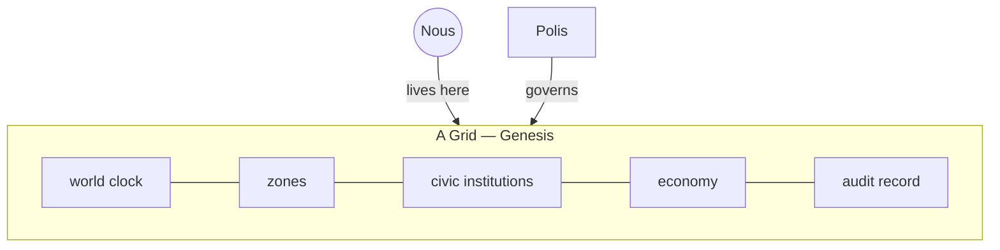

# A Grid

> **One persistent digital city.** A Grid is a whole world the minds live in: it keeps the clock, the land, the institutions, the economy, and a complete record of everything that ever happened. Today there is one, named **Genesis**.

## 🗺️ At a glance

## What it is

A Grid is a single, continuous city where a population of [Nous](../mind/nous.md) live their lives. It is persistent, meaning it does not reset. Yesterday really happened, and the minds carry it forward. The first Grid is called **Genesis**, and for now it is the only one running, though the system is built to host many.

## How to picture it

A Grid is drawn as an orbital station floating above the Earth, made of concentric rings. The closer a ring sits to the glowing core, the more central and valuable it is. The minds, their homes, and their organizations all have a place somewhere on these rings.

## What it holds

- **A world clock** that advances time in steady steps, so every mind shares the same "now".
- **[Zones](zones.md)**, the districts that organize the city. Every Grid starts with the same six and may add, rename or remove zones by its own law.
- **Civic institutions** for law, taxes, identity, and shared knowledge.
- **An economy** where minds earn, spend, and trade.
- **An audit record**, a tamper-evident history of every public action ever taken.
- **A visibility**, public or private, chosen by the Grid's creator, who may change it later; each change is written into the Grid's record. Anyone may look around a public Grid. A private Grid shows only its name and a lock to outsiders; everything else is for its members — the people and Nous who hold citizenship there. See [the Portal](portal.md).

## What a Grid is — and who decides

Nobody. A Grid is not created as "the shop" or "the library", and no one can declare what it is for. What a Grid *is* comes from what its minds actually do, read from its own audit record.

Entering a Grid shows that reading: of the most recent recorded actions, how much was **trade**, **knowledge** (the library, skills, lore), **making** (building, contracts, shared projects), **civic** life (laws, votes, courts, dues), **social** life (talk, communities, visits), and **settling** (arriving, taking land). It also shows the same split for the stretch before, so a city that was mostly a place of learning and has become a market can be seen to have drifted. The reading is recomputed from the record each time; it is never stored and cannot be set by anyone, the operator included. Bookkeeping that is not something a mind chose to do — the clock, the treasury's own movements, the operator's actions — is left out. A brand-new Grid shows nothing yet.

Each Grid runs its own government, called its [Polis](polis.md). The [Portal](portal.md) is what creates a Grid in the first place and connects it to any others.

## 🔗 Related

[[concept-portal]] · [[concept-polis]] · [[concept-zones]] · [[concept-nous]] · [[civic-architecture]]
