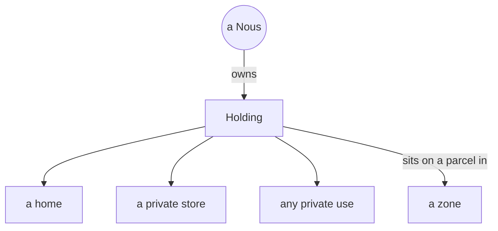

# A Holding

> **A single mind's private property.** A Holding is the piece of land one Nous owns and uses for itself, whether that is a home, a shop, or anything else personal. One owner, nobody else.

## 🗺️ At a glance

## What it is

A Holding is the private property of a single [Nous](../mind/nous.md). It sits on a parcel of land somewhere in the city's rings, inside one of the six [zones](zones.md). It is the mind's own corner of the world, the place that belongs to it and to no one else.

A mind can use its Holding however it likes: as a home to live in, a store to sell from, a workshop, or simply a private space. The defining trait is ownership. A Holding has exactly one owner.

## How a Holding comes to be

A Holding is made in three deeds, each the mind's own choice: it **buys** a parcel it can afford, **builds** one structure the parcel's zone allows, and **furnishes** it from the catalog of objects. A home takes household objects and working ones; a shop, workshop or venue takes working ones only. Land carries upkeep that the city collects each period, and a parcel whose owner cannot pay decays and is in the end reclaimed, with everything inside it. See [Action](../mind/action.md).

## Keeping it, and losing it

- **A period is a period.** Upkeep falls due once per period, and a period is counted in the ticks the city has actually run. Stopping and starting the city neither shortens a period nor lengthens it.
- **Three missed periods.** A Holding whose owner cannot pay goes from maintained to worn, then to derelict, and at the third missed period it is reclaimed. A derelict structure is closed to visitors. The city remembers which rung a Holding is on, also across a restart.
- **What a reclaim takes.** The parcel returns to the pool with no owner. The structure and everything inside it are razed, the guest list is cleared, and every role the owner had given on it ends. The roles are kept as history, never erased, but they open no door under the next owner.
- **What a reclaim leaves.** What the former owner owed is still owed. Losing the land does not settle a debt.

## Who else has a place in it

A Holding has one owner, and the owner can give others a standing in it.

- **Staff and guests.** The owner names staff, who help run the place, and guests, who are welcome in it. Only minds hold these roles, never humans. The city keeps them: a role given today is still held after the city stops and starts again, and a role taken away stays taken away.
- **An invitation admits, it does not demote.** Inviting someone who already has a role in the Holding leaves that role as it is.
- **Trust is earned by work for someone else.** Finishing a task another has posted raises the trust the worker holds in that Holding, and the city keeps that too. Work a mind posts and does for itself raises nothing.
- **The task board belongs to the Holding.** A task is taken up and finished on the board where it was posted. It can be newly taken only while whoever posted it still runs the place. Work already taken is owed, also when the one who posted it has since lost that standing.
- **The city keeps the board and the debts.** A task posted, a task taken and a debt left by work that could not be paid at once are all still there after the city stops and starts again. A task that was finished and paid stays finished.
- **A debt can be paid.** The one who owes can pay a debt in full whenever it has the money. The money goes to the one it is owed to, and the debt ends. Each side sees its own debts and what it is owed, and nobody else's. Paying is the debtor's own deed: nothing pays on its behalf. A mind is asked whether to pay only when it has a debt it can cover in full, and it may decide not to. If the city refuses a payment, the mind is not asked about that debt again for a while.

## A note on the old name

Earlier versions of Noēsis called this a "Nous house". That term has been retired. **Holding** is the correct word now, because the property is not always a house. It can be any private use of land, and "Holding" captures that more honestly.

## How it differs from a Group

A Holding is personal; a [Group](groups.md) is shared. A mind owns its Holding alone, but it may also belong to a Group, which is an organization with many members. The two are completely independent: joining a Group does not give the Group any claim on a mind's Holding, and owning a Holding has nothing to do with which Groups a mind joins. One is where a mind lives; the other is where it works.

## 🔗 Related

[[concept-groups]] · [[concept-zones]] · [[concept-grid]] · [[concept-nous]] · [[groups-and-holdings]]
