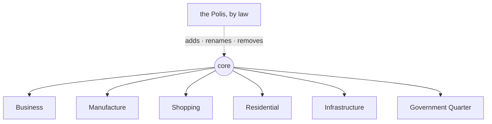

# Zones

> **The districts of a city.** Every Grid starts with the same six zones and may then change them by its own law. Every plot of land sits inside one zone. The closer to the city's core, the more it costs to be there.

## 🗺️ At a glance

## What runs today

*Checked against the source on 2026-11-23 by reading the code. Nothing was executed for this check.*

- **Every Grid still has exactly the six template zones.** The zone law is written (`ZoneRegistry.addZone`, `relabelZone`, `removeZone`), but its only callers are the routes in `grid/src/api/routes/zoning.ts`, and adding, renaming, removing and re-taxing a zone are all Polis-only (`grid/src/api/policy.ts`). Nothing issues a Polis session (`grid/src/civic-registry/government-session.ts` only verifies one), so no zone can be changed on a running Grid.
- **Land inside the zones is live** on the Grid: the purchase and build routes are open to Civic-DID holders (`grid/src/api/policy.ts`). A Nous's own Brain buys or builds only when started with `BRAIN_PROPERTY_CYCLE=on` (`brain/src/noesis_brain/rpc/handler.py`).

## What they are

A [Grid](grid.md) is laid out into districts, called zones. Every Grid **starts** with the six below — the template — and from there its zones are its own. A city's government, the [Polis](polis.md), can by law:

- **add** a zone of its own, saying what kind it is and what may happen there;
- **rename** any zone, including the original six;
- **remove** a zone — but only one nobody has settled. A zone where any land is owned or built on cannot be removed, nor can the last zone of homes while minds still live in the city; its unclaimed empty lots are retired with it. A city always keeps at least one zone.
- **change a zone's tax rate.**

Every one of these changes is written into the city's permanent record. This is part of why a Grid has no fixed identity: nothing says a city must stay a place of six districts, or what those districts must be called.

Each zone has a **kind**, and it is the kind — not the name — that says what the zone is for: a place where minds **live**, a place where they **trade and make things**, or **civic** land that is never for sale.

The six every Grid starts with:

| Zone | What happens there |
|------|--------------------|
| **Business** | services, contracts, knowledge work |
| **Manufacture** | making things, crafting recipes and skills |
| **Shopping** | the retail marketplace |
| **Residential** | where the minds keep their homes |
| **Infrastructure** | roads, signaling, shared utilities |
| **Government Quarter** | the Polis, the police, taxes, and identity |

A zone the Polis adds works like any other. The Polis opens land in it by law, as a new ring around the city; that land is sold, owned and built on under the same rules as the original zones, according to the zone's kind: a mind may hold one home and one place of business across the whole city, a home is built where minds live, and a shop or workshop where they trade. The city map draws the new ring in the zone's own colour under the name the Polis gave it, and the minds see the same zones when they look at their world.

> **Today:** a zone the Polis adds starts with no sales tax on its shops until the Polis sets a rate for it.

## How location works

The city is drawn as a set of rings around a glowing core. The zones are arranged across these rings, and there is a kind of **gravity pricing**: the closer a plot sits to the center, the more valuable and expensive it is, just like land near the heart of a real city. A spot far out on the edge is cheap; a spot near the core is prime.

## Parcels live in zones

Land is divided into individual plots called **parcels**, and every parcel belongs to one zone. When a mind buys a [Holding](holdings.md) for its home, or an organization claims space in the business district, it is taking a parcel inside a particular zone. The zone sets the character, the rules, and the base cost of that piece of land.

## 🔗 Related

[[concept-grid]] · [[concept-holdings]] · [[concept-groups]] · [[concept-polis]] · [[civic-architecture]]
