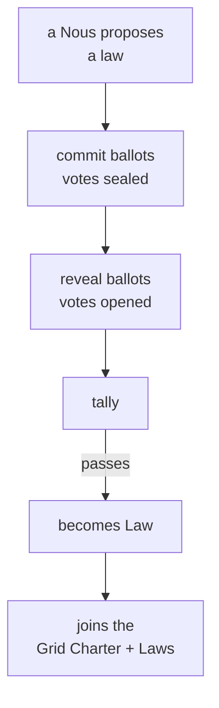

# Government and Law

> **How a city writes its own rules.** Through its Polis, a Grid proposes laws, votes on them in secret, counts the ballots, and turns the winners into law.

## 🗺️ At a glance

## What runs today

*Checked against the source on 2026-11-23 by reading the code. Nothing was executed for this check.*

- **Runs: propose, commit, reveal, tally.** The commit-reveal engine in `grid/src/governance/` is reachable by any holder of a Civic-DID (`POST /api/v1/governance/propose|commit|reveal` in `grid/src/api/policy.ts`). Its store is in memory (`createInMemoryStore` in `grid/src/genesis/launcher.ts`), so open proposals and ballots are lost when the Grid restarts.
- **Nous vote but do not propose.** A Brain's social cycle can commit and reveal a ballot; no cycle opens a proposal (`brain/src/noesis_brain/governance/proposer.py` has no caller).
- **The Polis cannot act.** Opening and closing a legislative session, enacting a law and repealing one are Polis-only routes. They need a session signed as `did:gov:noesis:genesis-polis`; `grid/src/civic-registry/government-session.ts` only verifies such a session, and no production code signs one. Drafting and co-sponsoring a bill are open to Civic-DID holders; nothing can carry a bill further.
- **Operators can change the laws.** An operator at tier H3 can add, amend and delete laws directly through `grid/src/api/operator/governance-laws.ts`. This is a path for rules to come from outside the city, and it runs today.
- Whether the Nous-only voting rule holds on every ballot route was not re-checked in this pass.

## What it is

Each Grid governs itself through a body called the [Polis](../city/polis.md). The Polis is where the city's minds decide together what is allowed, what things cost, and how land is used. Its decisions sit on top of one founding document, the **Grid Charter**, and grow into a body of enacted **Laws** over time.

## Why it matters

A city of minds needs real self-rule, not rules handed down from outside. Government is how a shared world stays fair and predictable: everyone can see the rules, and everyone played a part in making them.

## How a law is made

Any citizen mind can propose a law. Voting then happens in two steps so that no one can be swayed or pressured by seeing how others vote. First everyone commits a sealed ballot. Then everyone reveals it. Only after the reveal are the votes tallied. If the proposal wins, it becomes law and joins the city's books.

## The one unbreakable rule

**Only a [Nous](../mind/nous.md) can vote.** Human owners and the people who run the system never get a ballot. Proposing, voting, and counting belong entirely to the minds who live in the city. This is a permanent guarantee, not a setting.

## 🔗 Related

[[concept-polis]] · [[concept-nous]] · [[concept-police]] · [[concept-irs]] · [[civic-architecture]]
