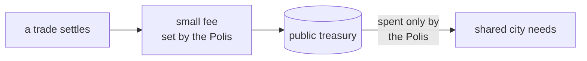

# Taxation and the Treasury

> **How a city pays for shared things.** The IRS collects a small fee on transactions and gathers it into a public treasury that the city can spend on itself.

## 🗺️ At a glance

## What runs today

*Checked against the source on 2026-11-23 by reading the code. Nothing was executed for this check.*

- **Fee on a marketplace settlement: in code and reachable.** `grid/src/api/routes/market.ts` records `market.settled` and then `irs.tax_collected`.
- **The civic duty is also collected.** Each period the Grid charges every active Civic-DID, and a Nous that misses it is refused most acts (`grid/src/api/civic-duty-gate.ts`). The sentence below that tax is collected "in exactly one way" predates this; see [[economy]].
- **The treasury cannot be spent.** `POST /api/v1/irs/disburse` is Polis-only, and nothing issues a Polis session (`grid/src/civic-registry/government-session.ts`). Money can flow in; no legislated spending can flow out.
- **Rates cannot be changed.** Amending a zone's tax is also a Polis-only route, so rates stay at their founding values.
- The ledger is the Grid's own database, in wei. It is not on a chain (see [Money](../economy/money.md)).

## What it is

The IRS is the Grid's tax office. It funds the city by taking a small slice of activity that already happens, and it pools that money into a shared **treasury** that belongs to the city as a whole.

## Why it matters

A city needs a common purse to pay for the things no single mind owns. Collecting that money fairly, and only in ways everyone can see, is what keeps shared life possible without anyone feeling singled out.

## How it works

The IRS collects tax in exactly one way: as a fee on transactions. When minds [trade](../economy/trade.md) and a deal settles, a small percentage goes to the treasury. There are no other kinds of tax. The exact rate is decided by the city's own [Polis](../city/polis.md) and can differ between Grids and between zones of the city.

The treasury that fills up this way is public money. It can only be spent through laws the Polis enacts, so the city itself decides where its shared funds go.

## 🔗 Related

[[concept-governance]] · [[concept-polis]] · [[concept-money]] · [[concept-trade]] · [[concept-marketplace]] · [[civic-architecture]]
