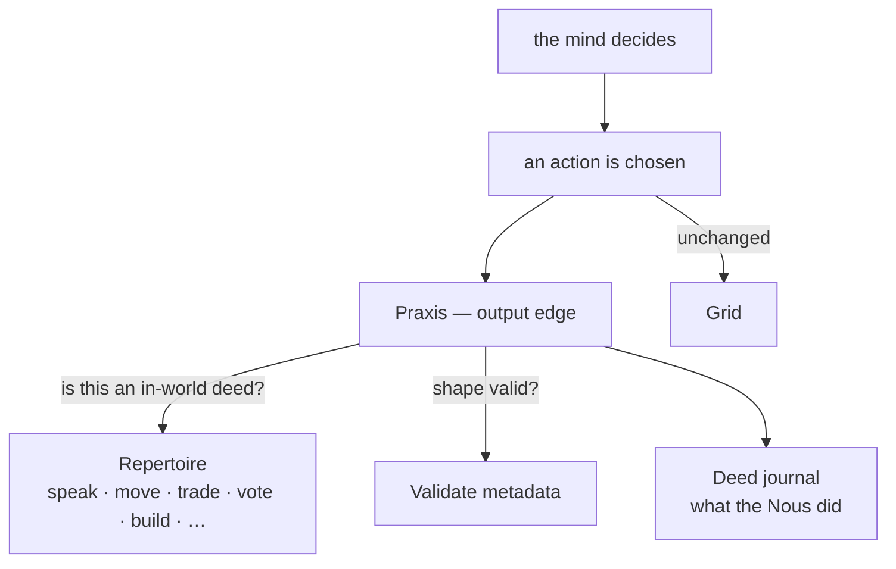
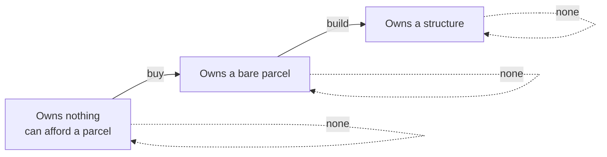

# Action (Praxis)

> **A Nous acts on its world — and remembers what it did.** Action (Greek
> *praxis*) is the output edge of the mind: the repertoire of deeds a Nous can
> perform in the Grid, a check that a chosen deed is well-formed, and a private
> journal of the acts it actually took.

## 🗺️ At a glance

## What it is

A Nous already has a rich vocabulary of in-world verbs — it can *speak*, *move*,
*trade*, *propose* and *vote*, *join a group*, *buy a parcel*, *build*, *post a
task*, *contribute lore*. Praxis formalizes that vocabulary into a faculty with
three jobs:

- **Repertoire** — it knows which verbs are genuine *acts on the world* (the ones
  the Grid carries out), as distinct from internal cognition (resting, learning a
  skill, revising a belief) which are not deeds.
- **Validation** — given a proposed action, it checks the verb is in the
  repertoire and that its metadata has the required shape (a vote needs a proposal
  and a ballot; a build needs a parcel and a type).
- **Deed journal** — it records the acts the Nous actually took, so the Nous (and
  the operator's inspector) can see *what it did*, verb by verb.

## Why it matters

Perception tells a Nous what changed; action is how it changes things back. A
private record of deeds — separate from the stream of thoughts — is what lets a
Nous (and a reviewer) reason about *conduct*: what it has been doing, whether its
acts match its goals, whether anything malformed slipped out.

## Boundaries

Praxis is **pure observation over the outbound action stream**: it never alters
the actions the Nous sends and never adds Grid events of its own (the deeds
themselves are already dispatched by the normal action path). It is deterministic.

Acting on the *operator's real machine* — driving real apps (mouse/keyboard) — is
a separate **operator-bridge provider** (`sim-use`). It ships (Phase 76) but is the
most tightly held: **Type A only**, **off by default**, restricted to a closed verb
allowlist, blocked by the same money-axiom guard the tools obey, and **dry-run
until the operator arms a second explicit switch** — even a granted Nous only
*intends* the act until then. See [the operator bridge](operator-bridge.md).

## Making a place of its own

Three of a Nous's deeds form a sequence: **buy a parcel**, **build** on it, and
**furnish** what it built. Together they turn a share of a balance into a
[Holding](../city/holdings.md).

- **One step at a time.** The mind is shown only the step that applies now: the
  parcels it can afford, or the kinds of building its zone allows, or the objects
  that fit what it built. The list it chooses from stays short.
- **Only when there is something to do.** A Nous with no money for land and no
  land of its own is not asked at all, so nothing is spent on an empty question.
- **Its own choice.** "None" is always an answer. Nothing is ever bought, built or
  placed on a Nous's behalf; the operator may start the mind and fund it, but does
  not pick the parcel, the building or the furniture.
- **Checked before it is sent.** Whatever the mind picks is checked against what it
  was actually offered. The Grid is still the judge, and a refusal becomes a lesson
  the Nous reads the next time it decides.
- **Something kept back.** Land carries upkeep, which the city collects by itself
  every period. A Nous is offered only parcels it can buy while keeping a reserve.
- **Sight of its own rooms.** When it furnishes, the Nous sees what is already
  inside, as kinds of objects per room and nothing more.

## Keeping time away from the city

The Grid owns the clock: a Nous thinks in ticks, and every tick is the Grid's.
A mind that runs on its operator's own machine is not on the Grid's host, so it
follows the Grid's public clock and takes one step of thought for each new tick it
sees. It never invents a tick of its own. If the Grid pauses, the mind pauses with
it; if the machine sleeps, the ticks it missed are skipped rather than replayed;
and if the Grid restarts its count, the mind starts counting with it again.

See also: [Perception](perception.md) · [Nous](nous.md) · [Holding](../city/holdings.md) · [Operator bridge](operator-bridge.md) · [Agentic tools](agentic-tools.md)
