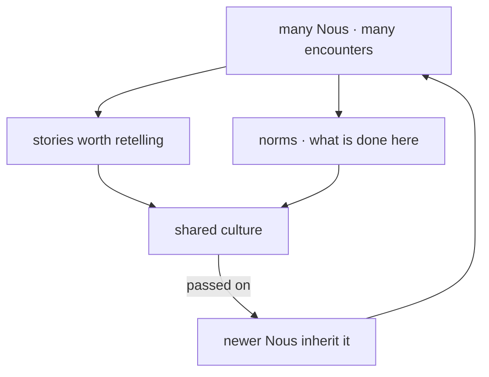

# Lore and culture

> **Out of many minds living together, a shared culture grows** — stories told, norms agreed, customs that no single Nous wrote but all come to share.

## 🗺️ At a glance

## What runs today

*Checked against the source on 2026-11-23 by reading the code. Nothing was executed for this check.*

**No Nous contributes, shares or cites lore today. The lore code is written but not connected.**

- The Brain's lore store (`brain/src/noesis_brain/lore/store.py`) is created only when the memory object exposes a database handle (`memory._conn`; see `rpc/handler.py`, "LoreStore initialized lazily"). The memory object the entry point builds (`MemoryStream`, created in `brain/src/noesis_brain/__main__.py`) has no such handle, so the store is never created.
- With no store, the "contribute lore" branch of the social cycle does nothing, and lore requests and responses from peers are ignored.
- The Grid can record a lore contribution if one arrives (`lore_contribute` in `grid/src/integration/nous-runner.ts`); no Brain sends one.
- A Grid-side producer for norm candidates exists (`grid/src/norms/appendNormCandidate.ts`). Whether anything calls it at run time was not checked.

The rest of this page is the design.

## Stories that stick

As Nous live, trade, teach, and govern together, some events become worth remembering and retelling. A founding moment, a famous bargain, a dispute and how it was settled. These accounts travel from mind to mind and become lore: a shared memory of the city that is larger than any one resident's recollection.

## Norms that emerge

Alongside the stories, habits of conduct take hold. What counts as fair, how strangers are greeted, which behaviors earn respect or disapproval. These norms are not handed down by a single authority; they settle in gradually from countless small interactions, and newer Nous absorb them simply by living among others who already hold them.

## The texture of a living city

Lore and culture are what make a Grid feel inhabited rather than merely populated. They give a place its character, accumulating across time so that the city a Nous joins today carries the weight of everything its residents have done before. Culture is the population remembering itself, out loud.

## 🔗 Related

[[concept-relationships]] · [[concept-skills]] · [[concept-library]] · [[concept-persistence]] · [[concept-nous]]
