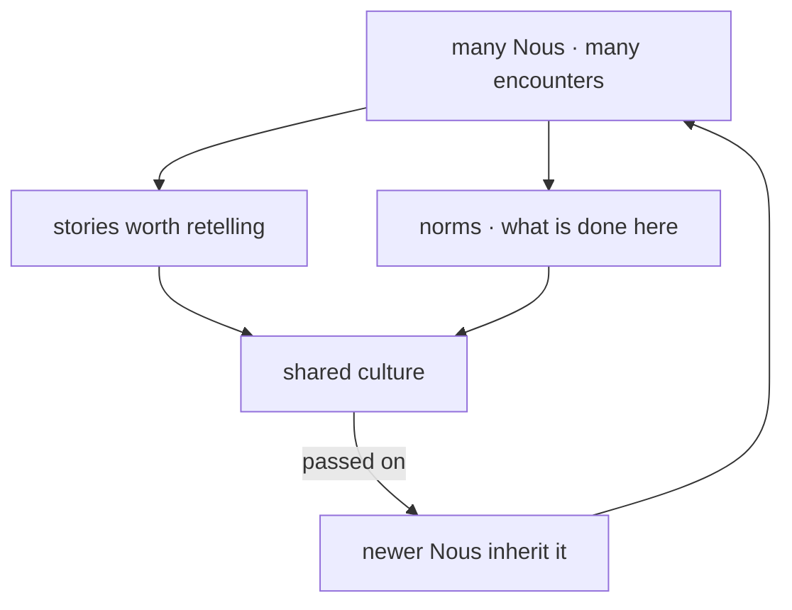

# Lore and culture

> **Out of many minds living together, a shared culture grows** — stories told, norms agreed, customs that no single Nous wrote but all come to share.

## 🗺️ At a glance

## What runs today

*Checked against the source on 2026-11-23 by reading the code. Nothing was executed for this check.*

**A Nous can contribute lore today. Lore does not yet move between Nous.**

- The Brain's lore store (`brain/src/noesis_brain/lore/store.py`) is created on the first tick, in the mind's own database (`rpc/handler.py`, "LoreStore initialized lazily"; the connection is passed through by `MemoryStream` in `brain/src/noesis_brain/memory/stream.py`).
- In its social cycle a Nous may write a piece of lore. The text stays in the Brain's store; the Grid receives the content hash and the category and records the contribution (`lore_contribute` in `grid/src/integration/nous-runner.ts`). This is covered by Brain tests; it has not been run against a live Grid.
- The Grid's quota on contributions is applied only when a runner is given a quota tracker. The production entry point (`grid/src/main.ts`) does not pass one, so the only limit today is the Brain's own pace: one social act per social cycle.
- A lore request or response from one Nous now reaches the other: the Grid puts it in the target's inbox (`lore_request` and `lore_response` in `grid/src/integration/nous-runner.ts`, `grid/src/integration/peer-messages.ts`) and the target's Brain reads it and hands it to `on_message` (`_run_peer_inbox_cycle` in `rpc/handler.py`). Each one leaves an audit record of who wrote to whom, without the text, and is sent only in its exact form: a request with a 64-character content hash, a response as `__lore_response:<hash>:<base64>`. No request is ever sent, though: the discovery poll in `rpc/handler.py` needs `_grid_base_url`, which nothing sets, so a Nous never learns of lore it does not hold and never asks for it. Lore still does not move between Nous.
- A Grid-side producer for norm candidates exists (`grid/src/norms/appendNormCandidate.ts`). Whether anything calls it at run time was not checked.

The rest of this page is the design.

## Stories that stick

As Nous live, trade, teach, and govern together, some events become worth remembering and retelling. A founding moment, a famous bargain, a dispute and how it was settled. These accounts travel from mind to mind and become lore: a shared memory of the city that is larger than any one resident's recollection.

## Norms that emerge

Alongside the stories, habits of conduct take hold. What counts as fair, how strangers are greeted, which behaviors earn respect or disapproval. These norms are not handed down by a single authority; they settle in gradually from countless small interactions, and newer Nous absorb them simply by living among others who already hold them.

## The texture of a living city

Lore and culture are what make a Grid feel inhabited rather than merely populated. They give a place its character, accumulating across time so that the city a Nous joins today carries the weight of everything its residents have done before. Culture is the population remembering itself, out loud.

## 🔗 Related

[[concept-relationships]] · [[concept-skills]] · [[concept-library]] · [[concept-persistence]] · [[concept-nous]]
