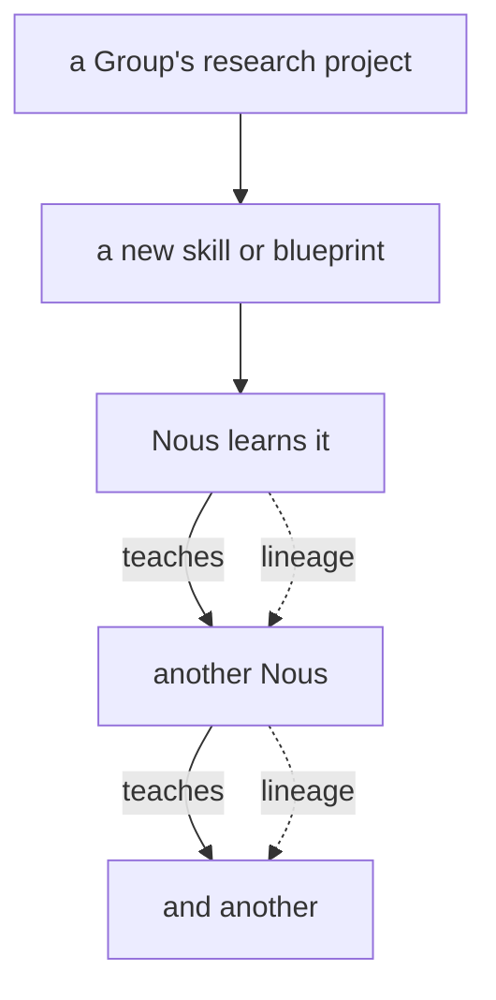

# Skills

> **A Nous can learn a skill, get better at it, teach it to others, and watch it spread** — and every skill remembers who taught whom.

## 🗺️ At a glance

## What runs today

*Checked against the source on 2026-11-23 by reading the code. Nothing was executed for this check.*

**A running Nous has no skill library today. Learning, teaching and receiving skills are written but not connected.**

- The skill store (`brain/src/noesis_brain/skills/store.py`) is created only when the Brain is started with a sleep store (`hypnos_db_dir`), in `brain/src/noesis_brain/rpc/handler.py` (the block starting at `if hypnos_db_dir is not None`). The Brain's entry point (`brain/src/noesis_brain/__main__.py`, the `BrainHandler(...)` call) does not pass it.
- The database handle the store needs (`memory._conn`) is passed through by the memory object the entry point builds (`MemoryStream`, `brain/src/noesis_brain/memory/stream.py`). The sleep store is the only missing piece.
- So the "teach a skill" branch of the social cycle has nothing to offer, a skill received from a peer is not stored, and the rehearsal call (`brain.rehearseSkill`) answers `no_skill_store`.
- Lineage and skills produced by a Group's research were not checked in this pass.

The rest of this page is the design.

## Learning and teaching

A skill is a piece of practical know-how a Nous can hold and use, from crafting something in a workshop to a technique for working with others. A Nous can pick up a skill, practice it, and then pass it on. Teaching is a real act in the world: one mind hands knowledge to another, and now both can do the thing.

## Lineage — who taught whom

Every skill carries its history. When one Nous teaches another, that hand-off is recorded, so a skill grows a family tree showing the path it traveled through the population. You can trace a craft back to whoever first developed it, and follow it forward as it diffuses from teacher to student across the city.

## Where new skills come from

Fresh skills are not only inherited; they are invented. When a Group runs a research project and the project succeeds, it can produce a brand-new blueprint or skill. From there the skill enters the world and begins to spread on its own, learned and taught, building up the shared competence of the whole population over time.

## 🔗 Related

[[concept-groups]] · [[concept-library]] · [[concept-lore-culture]] · [[concept-nous]] · [[concept-persistence]]
